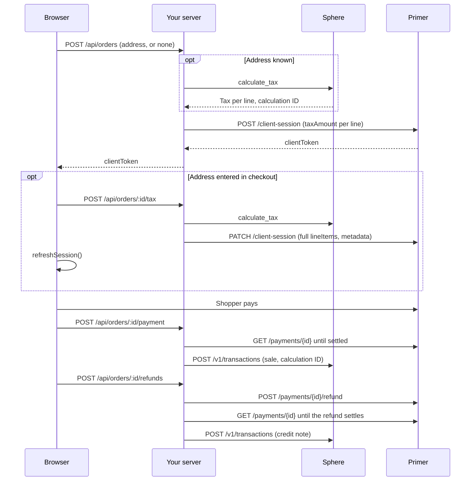
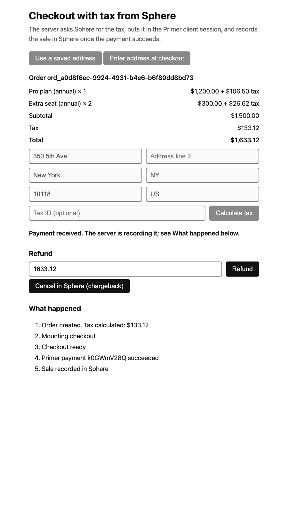

# Real-time tax with Sphere in Primer Checkout

Your server asks Sphere for the tax on an order and passes it to Primer in the client session, so Primer Checkout shows the total with tax on the pay button. After payment the server records the sale in Sphere, each refund as a credit note, and a chargeback as a cancellation. For concepts, see the [Sphere guide](https://primer.io/docs/connections/tax-providers/sphere).

Use a Sphere test organization: the example records real sales, credit notes and cancellations, and the code can't tell a test key from a live one. Ran end to end against the Primer and Sphere sandboxes.

## How it works

Address known before checkout ("Use a saved address"):

1. `POST /api/orders` (`server/orders.js`) calls Sphere's `calculate_tax` for the cart in `server/catalog.js`, then creates the Primer client session with each line's `taxAmount`, the billing address and the calculation ID in `metadata`.
2. The page (`public/app.js`) mounts `<primer-checkout>`.

Address entered in checkout ("Enter address at checkout"):

1. `POST /api/orders` creates the session with `taxAmount: 0` on every line.
2. The shopper submits the address form. `POST /api/orders/:id/tax` calculates tax and sends `PATCH /client-session` with the full `lineItems` and `metadata`.
3. The page calls `primer.refreshSession()`.
4. On each `primer:payment-start`, `public/app.js` calls `preventDefault()` synchronously. It aborts if there is no tax quote (a fail-open quote counts), the form no longer matches the quoted address, or a payment was already reported for the order. Otherwise it calls `continuePaymentCreation({ idempotencyKey })` with `<orderId>:<attempt>`.

After payment:

1. On `primer:payment-success` the page posts the payment id to `POST /api/orders/:id/payment`. The server fetches the payment and checks it against the order. An `AUTHORIZED`, `PENDING` or `SETTLING` payment is polled every 1.5 seconds for up to 15 seconds, then waits as `AWAITING_CAPTURE` for the worker.
2. Once the payment is `SETTLED` or `PARTIALLY_SETTLED`, the server fetches it with `GET /payments/{id}?expand=transactions.events` to read the capture time from its latest `CAPTURE_SUCCEEDED` event. It saves the sale in `sphere_writes` and marks the order `PAID` in one database transaction, then sends it to Sphere with the order id as `external_id`, the calculation ID, the capture time as `finalized_on` and any tax ID.
3. `POST /api/orders/:id/refunds` (`server/refunds.js`) splits the refund across the lines and asks Primer to refund. When Primer reports it `SETTLED`, the server queues a credit note linked to the sale.
4. `POST /api/orders/:id/cancel-in-sphere` cancels the sale in Sphere. It stands in for a chargeback. In production, trigger the cancellation from a dispute webhook.
5. A worker (`server/worker.js`) runs every 5 seconds: it retries Sphere writes, checks pending refunds, finishes late captures and finds unreported payments. It checks a waiting payment every tick at first, every 30 seconds after 2 minutes and every 5 minutes after an hour.



## Prerequisites

- A Primer API key with scopes `client_tokens:write`, `transactions:read` and `transactions:refund`.
- A Primer Workflow with a processor. Enable only cards for this checkout.
- A Sphere API key that can call both `calculate_tax` and the Transaction API,.
- A Sphere product tax code, in `SPHERE_TAX_CODE`. Ask Sphere which code applies to you.
- Sphere registrations in the places you test.
- Node 22.13 or later.

## Run it

```bash
cp .env.example .env   # fill in the values, including SPHERE_TAX_CODE
npm install
npm run seed           # creates the two demo products in Sphere with that tax code
npm start
```

The server listens on `http://127.0.0.1:3000` (`HOST`, `PORT`), reads `.env` only at startup, and calls Primer's sandbox unless you set `PRIMER_API_HOST`. "Use a saved address" sends a New York address. "Enter address at checkout" creates the session without tax: fill in the address form and press "Calculate tax".

Pay with a test card for your Workflow's processor, such as [the Primer Sandbox Processor's](https://primer.io/docs/testing/primer-sandbox-processor). After a payment the page shows a refund form and a "Cancel in Sphere (chargeback)" button.

## What a successful run looks like



After a payment with the saved address, the "What happened" list reads:

```text
Order created. Tax calculated: $133.12
Mounting checkout
Checkout ready
Primer payment <id> succeeded
Sale recorded in Sphere
```

The summary shows $1,200.00 + $106.50 tax and $300.00 + $26.62 tax, total $1,633.12. A refund of 500.00 logs "Refund settled, credit note recorded in Sphere".

## Things to know

- The sale is recorded only at `SETTLED` or `PARTIALLY_SETTLED`, not `SETTLING`, which can still be cancelled, so a voided authorization is never recorded. Partial capture is not handled: the example records no credit note for an uncollected remainder.
- The server polls `GET /payments/{id}` to confirm payments and refunds, and finds a payment from a closed tab with `GET /payments?order_id=`. In production, use the `PAYMENT.STATUS` and `PAYMENT.REFUND` webhooks.
- The example checks only that the required address fields are present. Validate addresses before calculating tax: Sphere may place an invalid address in a jurisdiction instead of returning an error.
- The example fails open only when `calculate_tax` times out (2 seconds), returns 429 or returns 5xx. The shopper pays without tax (`NOT_COLLECTED`), and the sale is recorded without a calculation ID, with `taxCollected: 'false'` in its metadata.
- Only `customer_tax_location_invalid` is shown to the shopper, who can fix the address. Any other Sphere error that does not fail open, such as `invalid_product_tax_code` or a 401, is a setup problem: the server logs it, returns a generic error and blocks payment.
- A tax ID entered with the address goes to `calculate_tax` and, as `customer_tax_ids`, on the sale but not on credit notes.
- Where you aren't registered, Sphere returns zero tax, and the sale is recorded with the calculation ID if there is one.
- With several partial refunds, Sphere rounds each credit note's tax separately, so the total tax credited can differ from the sale's tax by a cent.
- Before recording a sale, the server checks the payment's order id, amount, currency and calculation ID against the order. `NOT_CALCULATED` fails the check; `NOT_COLLECTED` passes.
- Refunds are accepted only while the sale status is `RECORDED` (not `PENDING`, `FAILED` or any cancellation status). Cancellation is refused while a refund or credit note is pending. A voided authorization tells the shopper to start a new order.
- Primer 401, 403, 408 and 429 answers are retried like a timeout when confirming a payment or refund.
- State is a SQLite file, `data/orders.db` by default (`DB_PATH`).
- Log tags that need a person:
  - `NEEDS_REVIEW`: a payment failed the check, hit a final error or had no capture event, an authorization was not captured after 24 hours, or a `SETTLING` payment had not settled after 14 days. Check Primer.
  - `SECOND_PAYMENT`: an order received a second payment. Refund it in Primer.
  - `STRANDED?`: confirming a payment failed unexpectedly, and the shopper is told not to pay again. Check Primer.
  - `REFUND_UNMATCHED`: after 30 minutes Primer shows no refund with the refund id. Check Primer before refunding again.
  - `REFUND_NEEDS_REVIEW`: checking a refund hit a final error, or Primer rejected a resend. Check Primer before refunding again.
  - `SPHERE_WRITE_FAILED`: Sphere gave a final 4xx answer to a write. The row stays `FAILED` until requeued.
  - `SPHERE_SETUP_ERROR`: Sphere rejected the tax request for a reason the shopper can't fix, such as an unknown product tax code. Payment is blocked. Fix the setup.
  - `SPHERE_AUTH_FAILED`: Sphere answered 401 or 403. Writes keep retrying. Fix the key.
  - `PRIMER_AUTH_FAILED`: Primer answered 401 or 403. Fix `PRIMER_API_KEY`.
  - `UNREPORTED_ORDER_EXPIRED`: no payment after 24 hours and the worker stopped searching. If the shopper paid, find it in Primer.
- To requeue a `FAILED` Sphere write after fixing the cause, run this from this directory. Replace `ord_...` with the write's id (the order id, `<order id>-refund-<n>` or `<order id>-cancel`) from the failure log line. If you set `DB_PATH`, use it.

  ```bash
  node -e "const {DatabaseSync}=require('node:sqlite'); const db=new DatabaseSync('data/orders.db'); console.log(db.prepare(\"UPDATE sphere_writes SET status='PENDING', attempts=0, last_error=NULL, next_attempt_at=strftime('%Y-%m-%dT%H:%M:%fZ','now'), updated_at=strftime('%Y-%m-%dT%H:%M:%fZ','now') WHERE external_id=? AND status='FAILED'\").run('ord_...'))"
  ```

  The worker picks it up within 5 seconds. If the request body was the problem, it fails again.

- Pricing is tax-exclusive only. The server rejects a rate marked `tax_rate.inclusive`.
- The API routes have no auth. Add it before exposing them.
- The page sets no `redirect.returnUrl`, so Primer Checkout fails to start if a redirect method is enabled.

## Docs

- [Sphere guide](https://primer.io/docs/connections/tax-providers/sphere)
- [Create a client session](https://primer.io/docs/api-reference/v2.4/api-reference/client-session-api/create-a-client-session)
- [Update a client session](https://primer.io/docs/api-reference/v2.4/api-reference/client-session-api/update-client-session)
- [`refreshSession()`](https://primer.io/docs/sdk/primer-checkout-web/events-reference#refreshsession)
- [`primer:payment-start`](https://primer.io/docs/sdk/primer-checkout-web/events-reference#primerpayment-start)
- [Refund a payment](https://primer.io/docs/manage-payments/refund-payment)
- [Sphere Tax Calculation API](https://docs.getsphere.com/features/integrations/api/tax-calculation)
- [Sphere Transactions](https://docs.getsphere.com/features/integrations/api/transaction-api/transactions)
