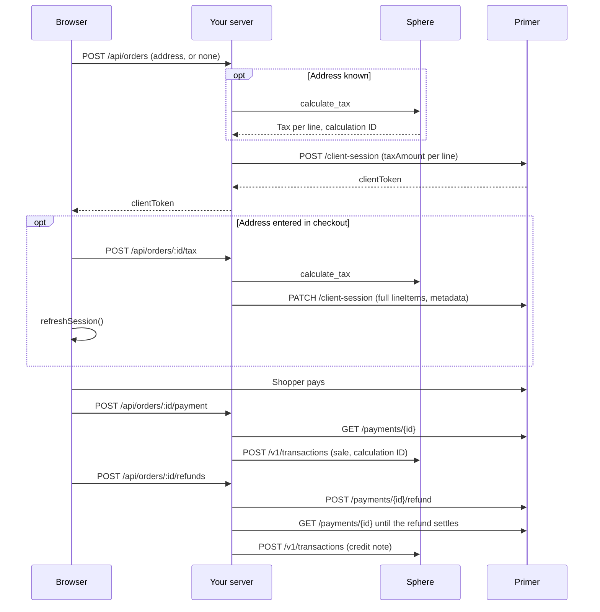
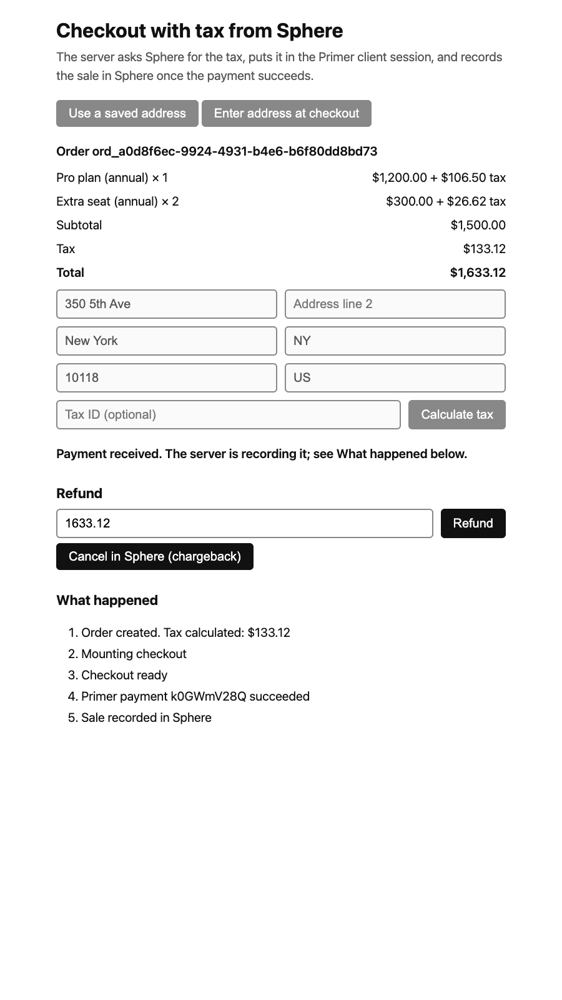

# Real-time tax with Sphere in Primer Checkout

Your server asks Sphere for the tax on an order and passes it to Primer in the client session, so Primer Checkout shows the total with tax on the pay button. After payment the server records the sale in Sphere, each refund as a credit note, and a chargeback as a cancellation. For concepts, see the [Sphere guide](https://primer.io/docs/connections/tax-providers/sphere).

Use a Sphere test organization: the example records real sales, credit notes and cancellations, and nothing in the code can tell a test key from a live one. Ran end to end against the Primer and Sphere sandboxes.

## How it works

Address known before checkout ("Use a saved address"):

1. `POST /api/orders` (`server/orders.js`) calls Sphere's `calculate_tax` for the cart in `server/catalog.js`, then creates the Primer client session with each line's `taxAmount`, the billing address and the calculation ID in `metadata`.
2. The page (`public/app.js`) mounts `<primer-checkout>`, which shows the total with tax.

Address entered in checkout ("Enter address at checkout"):

1. `POST /api/orders` creates the session with `taxAmount: 0` on every line.
2. The shopper submits the address form. `POST /api/orders/:id/tax` calculates tax and sends `PATCH /client-session` with the full `lineItems` and `metadata`.
3. The page calls `primer.refreshSession()`.
4. On each `primer:payment-start`, `public/app.js` calls `preventDefault()` synchronously. It aborts if there is no tax quote (a fail-open quote counts), the form no longer matches the quoted address, or a payment was already reported for the order. Otherwise it calls `continuePaymentCreation({ idempotencyKey })` with `<orderId>:<attempt>`, where the attempt rises on every `primer:payment-start`.

After payment:

1. On `primer:payment-success` the page posts the payment id to `POST /api/orders/:id/payment`. The server fetches the payment from Primer and checks it against the order. An authorized payment is polled every 1.5 seconds for up to 15 seconds.
2. Once the payment is `SETTLING`, `SETTLED` or `PARTIALLY_SETTLED`, the server saves the sale in `sphere_writes` and marks the order `PAID` in one database transaction, then sends it to Sphere with the order id as `external_id`, the calculation ID and the payment date.
3. `POST /api/orders/:id/refunds` (`server/refunds.js`) splits the refund across the lines and asks Primer to refund. When Primer reports it `SETTLED`, the server queues a credit note linked to the sale.
4. `POST /api/orders/:id/cancel-in-sphere` cancels the sale in Sphere. It stands in for a chargeback.
5. A worker (`server/worker.js`) runs every 5 seconds: it retries Sphere writes, checks pending refunds, finishes late captures and finds unreported payments.



## Prerequisites

- A Primer API key with scopes `client_tokens:write`, `transactions:read` and `transactions:refund`.
- A Primer Workflow with a processor. Enable only cards for this checkout.
- A Sphere API key that can call both `calculate_tax` and the Transaction API,.
- A Sphere product tax code, in `SPHERE_TAX_CODE`. Ask Sphere which code applies to you.
- Sphere registrations in the places you test.
- Node 22.13 or later.

## Run it

```bash
cp .env.example .env   # fill in the values, including SPHERE_TAX_CODE
npm install
npm run seed           # creates the two demo products in Sphere with that tax code
npm start
```

The server listens on `http://127.0.0.1:3000` (`HOST`, `PORT`), reads `.env` only at startup, and calls Primer's sandbox unless you set `PRIMER_API_HOST`. "Use a saved address" sends a New York address. "Enter address at checkout" creates the session without tax: fill in the address form and press "Calculate tax".

Pay with a test card for your Workflow's processor. For the Primer Sandbox Processor, see [its test cards](https://primer.io/docs/testing/primer-sandbox-processor). After a payment the page shows a refund form and a "Cancel in Sphere (chargeback)" button.

## What a successful run looks like



After a payment with the saved address, the "What happened" list reads:

```text
Order created. Tax calculated: $133.12
Mounting checkout
Checkout ready
Primer payment <id> succeeded
Sale recorded in Sphere
```

The summary shows $1,200.00 + $106.50 tax and $300.00 + $26.62 tax, total $1,633.12, matching the guide. A refund of 500.00 logs "Refund settled, credit note recorded in Sphere".

## Things to know

- The sale is recorded at capture, so a voided authorization is never recorded. Partial capture is not handled: the example records no credit note for an uncollected remainder.
- The example fails open only when `calculate_tax` times out (2 seconds), returns 429 or returns 5xx. The shopper pays without tax (`NOT_COLLECTED`), and the sale is recorded without a calculation ID, with `taxCollected: 'false'` in its metadata. Any other 4xx is shown to the shopper, except a Sphere 401, 403 or 408 or `invalid_product_tax_code`, which return a generic error.
- Where you aren't registered, Sphere returns zero tax. The sale is recorded with the calculation ID if Sphere returns one.
- With several partial refunds, Sphere calculates each credit note's tax itself, and rounding can make a credit note differ from its refund by a cent. Refunds of 500.00, 500.00 and 633.12 on the guide's New York order produced credit notes of 500.00, 500.01 and 633.12, so credited tax was 133.13 against 133.12 collected. Net amounts summed exactly. Sending `tax_inclusive: true` on credit lines doesn't help: Sphere treated those amounts as net.
- Before recording a sale, the server checks the payment's order id, amount, currency and the calculation ID in its metadata against the order. An order with no tax quote (`NOT_CALCULATED`) fails the check. A `NOT_COLLECTED` order passes.
- Refunds are accepted only while the sale status is `RECORDED`, not `PENDING`, `FAILED` or after a cancellation (`CANCEL_PENDING`, `CANCEL_FAILED`, `CANCELLED`). Cancellation is refused while a refund or credit note is pending. A payment awaiting capture keeps the page updating. A voided authorization tells the shopper to start a new order.
- When confirming a payment or refund, Primer 401, 403, 408 and 429 answers are retried like a timeout.
- State is a SQLite file, `data/orders.db` by default (`DB_PATH`). Node may print an experimental warning.
- Log tags that need a person:
  - `NEEDS_REVIEW`: a payment failed the check, hit a final error, or was uncaptured after 24 hours. Check Primer.
  - `SECOND_PAYMENT`: an order received a second payment. Refund it in Primer.
  - `STRANDED?`: confirming a payment failed unexpectedly. The shopper is told not to pay again. Check Primer.
  - `REFUND_UNMATCHED`: 30 minutes on, Primer shows no refund carrying the refund id. Check Primer before refunding again.
  - `REFUND_NEEDS_REVIEW`: checking a refund hit a final error, or Primer rejected a resend. Check Primer before refunding again.
  - `SPHERE_WRITE_FAILED`: Sphere gave a final 4xx answer to a write. The row stays `FAILED` until requeued.
  - `SPHERE_AUTH_FAILED`: Sphere answered 401 or 403. Writes keep retrying. Fix the key.
  - `PRIMER_AUTH_FAILED`: Primer answered 401 or 403. Fix `PRIMER_API_KEY`.
  - `UNREPORTED_ORDER_EXPIRED`: an order has no payment after 24 hours and the worker stopped searching. If the shopper paid, find it in Primer.
- To requeue a `FAILED` Sphere write after fixing the cause, run this from this directory. Replace `ord_...` with the write's id (the order id, `<order id>-refund-<n>` or `<order id>-cancel`), which the failure log line shows. If you set `DB_PATH`, use that path.

  ```bash
  node -e "const {DatabaseSync}=require('node:sqlite'); const db=new DatabaseSync('data/orders.db'); console.log(db.prepare(\"UPDATE sphere_writes SET status='PENDING', attempts=0, last_error=NULL, next_attempt_at=strftime('%Y-%m-%dT%H:%M:%fZ','now'), updated_at=strftime('%Y-%m-%dT%H:%M:%fZ','now') WHERE external_id=? AND status='FAILED'\").run('ord_...'))"
  ```

  The worker picks it up within 5 seconds. If the request body was the problem, it fails again.

- Pricing is tax-exclusive only, as in the guide. The server rejects a rate marked `tax_rate.inclusive`.
- The API routes have no auth. Add it before exposing them.
- The page sets no `redirect.returnUrl`, so Primer Checkout fails to start if a redirect method is enabled.

## Where this differs from the guide

- No webhooks. The server confirms payments and refunds by polling `GET /payments/{id}`, and finds a payment from a closed tab with `GET /payments?order_id=`. In production, use the `PAYMENT.STATUS` and `PAYMENT.REFUND` webhooks.
- The guide says only `SETTLED` and `PARTIALLY_SETTLED` payments can be refunded. The example doesn't check that: it sends the refund and shows Primer's error if it can't be made.
- A chargeback is a "Cancel in Sphere" button. In production, use a dispute webhook.
- The guide writes `POST /v1/transactions/{id}/cancel` and never defines `{id}`. This example uses the sale's `external_id`, which is the order id.
- No address validation beyond required fields. The guide recommends validating addresses first, because Sphere may place an invalid address in a jurisdiction instead of returning an error.
- Partial capture is not handled (see Things to know).
- The `primer:payment-start` guard lets a fail-open quote through, so the shopper can pay when Sphere is down. The guide's guard checks only that tax matches the address on screen.

## Docs

- [Sphere guide](https://primer.io/docs/connections/tax-providers/sphere)
- [Create a client session](https://primer.io/docs/api-reference/v2.4/api-reference/client-session-api/create-a-client-session)
- [Update a client session](https://primer.io/docs/api-reference/v2.4/api-reference/client-session-api/update-client-session)
- [`refreshSession()`](https://primer.io/docs/sdk/primer-checkout-web/events-reference#refreshsession)
- [`primer:payment-start`](https://primer.io/docs/sdk/primer-checkout-web/events-reference#primerpayment-start)
- [Refund a payment](https://primer.io/docs/manage-payments/refund-payment)
- [Sphere Tax Calculation API](https://docs.getsphere.com/features/integrations/api/tax-calculation)
- [Sphere Transactions](https://docs.getsphere.com/features/integrations/api/transaction-api/transactions)
