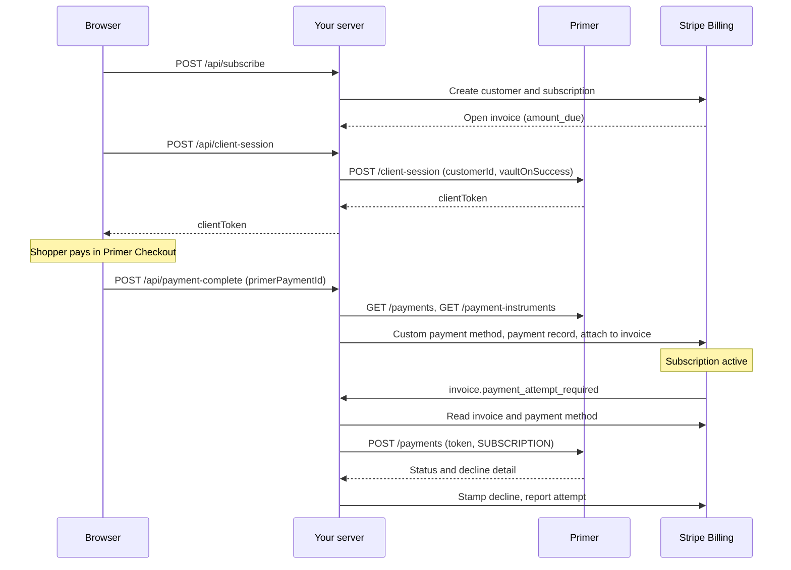

# Stripe Billing with Primer: Stripe owns the subscription, Primer processes the payments

Stripe Billing keeps the plan, subscription and invoices. Primer Checkout takes and vaults the first payment, and your server charges each renewal through Primer when Stripe asks. All state lives in Stripe. For concepts and Dashboard setup, see the [Stripe Billing guide](https://primer.io/docs/subscriptions/stripe-billing). Sandbox only: `server/config.js` refuses Stripe keys that don't start with `sk_test_` or `rk_test_`.

## How it works

First payment:

1. Subscribe: `POST /api/subscribe` (`server/app.js`) creates the customer and an incomplete subscription with an open invoice (`server/stripe.js`).
2. Client session: `POST /api/client-session` (`server/primer.js`) uses the invoice's `amount_due`, the Stripe customer id, `vaultOnSuccess` and `FIRST_PAYMENT` with `firstPaymentReason: 'Recurring'`.
3. Checkout: `public/app.js` mounts `<primer-checkout>` and, on `primer:payment-success`, posts the payment id to `POST /api/payment-complete`.
4. Payment-complete (`server/first-payment.js`): verify the Primer payment against the invoice, find the `MULTI_USE` vaulted token, store it in a Stripe custom payment method, report the payment to Stripe, and attach it to the invoice, which activates the subscription.

Renewals:

1. Stripe webhook: `invoice.payment_attempt_required` reaches `server/webhooks.js`.
2. Primer MIT payment: `server/renewal.js` charges the stored token with `paymentType: 'SUBSCRIPTION'`.
3. Classify: `classifyPayment` (`server/primer.js`) returns approved, pending, hard, soft or unknown. Unknown reports nothing.
4. Stamp: a decline goes into invoice metadata for Stripe's automations.
5. Report: `reportRenewalAttempt` (`server/stripe.js`) records the attempt on the invoice's payment record.

The Primer `PAYMENT.STATUS` webhook (`server/primer-events.js`) settles PENDING payments and also reports the first payment in case `POST /api/payment-complete` never arrives.



## Prerequisites

See the [guide's prerequisites](https://primer.io/docs/subscriptions/stripe-billing#prerequisites). This example needs:

- A Primer API key with scopes `client_tokens:write`, `transactions:authorize`, `transactions:read` and `payment_instrument:read`.
- A Primer Workflow with a processor.
- Stripe third-party payment processing, enabled by your Stripe account team.
- A Stripe custom payment method type, with its id in `STRIPE_CPM_TYPE_ID`.
- A Stripe webhook for `invoice.payment_attempt_required`.
- A Primer webhook for `PAYMENT.STATUS`. PENDING payments normally settle through this webhook.
- A retry schedule, and a Stripe Billing automation that reads the invoice metadata `primer_decline_classification` for hard declines.
- Node 22 or later.

## Run it

```bash
cp .env.example .env   # fill in the values
npm install
stripe listen --print-secret   # copy the whsec_... value into STRIPE_WEBHOOK_SECRET in .env
npm start
```

The server listens on `http://127.0.0.1:3000` by default (`HOST`, `PORT`). In a second terminal, forward Stripe events to it:

```bash
stripe listen --events invoice.payment_attempt_required --forward-to 127.0.0.1:3000/api/webhooks/stripe
```

Open the page and pay with a test card for the processor in your Primer Workflow. For the Primer Sandbox Processor, see [its test cards](https://primer.io/docs/testing/primer-sandbox-processor).

The server reads `.env` only at startup, so restart it after any change.

A first card test needs no public tunnel for the Primer webhook, but `PRIMER_WEBHOOK_SECRET` must still be set because the server checks for it at startup. A placeholder works when you skip the tunnel. You need the tunnel for PENDING payments and for the webhook's backup report of a first payment: tunnel to the server's port and register `<tunnel URL>/api/webhooks/primer` in Primer. Then replace the placeholder in `PRIMER_WEBHOOK_SECRET` with the real secret, which the server uses to verify each webhook's signature, and restart the server. The tunnel exposes every route, so keep it to sandbox.

For renewals, set `STRIPE_USE_TEST_CLOCK=1`, restart the server, then subscribe and complete a first payment. A subscription created before the restart has no clock, and `advance-clock` says so. Run `npm run advance-clock -- <subscriptionId>`. It advances the clock once. Wait for `renewal reported` in the server log before running it again: in our testing, Stripe returned `429` for writes while a test clock advanced (observed, not documented), and the server retries once when that happens.

## What a successful run looks like


After a first payment, the "What happened" list on the page reads:

```text
Subscription sub_… created, first invoice in_… for <amount>
Checkout session created
Mounting checkout
Checkout ready
Primer payment <payment id> succeeded
Reported to Stripe: subscription is active
```

`npm run advance-clock -- sub_…` prints:

```text
Advancing <clock id> to <renewal time>
Clock is ready. In the server log, look for:
  renewal requested ...   Stripe asked for payment
  renewal outcome ...     Primer answered, with its classification
  renewal reported ...    Stripe has the outcome; safe to advance again
Then check the subscription and invoice in the Stripe Dashboard.
```

The server log then shows these three lines, and the outcome ends in `approved`:

```text
renewal requested in_… <amount in minor units> <currency>
renewal outcome <payment id> <status> approved
renewal reported in_… Primer payment <payment id> paid
```

A line starting with `STRANDED`, `OUTCOME UNKNOWN` or `renewal failed` means something needs attention. [Things to know](#things-to-know) explains `STRANDED` and `OUTCOME UNKNOWN`. A `renewal failed` line names the Stripe event, the invoice and the error.

## Things to know

- Report the first payment within 23 hours, or Stripe expires the subscription (`server/first-payment.js`, guide).
- Amounts come from the Stripe invoice, never the browser.
- Webhooks get a 200 before any work (`server/webhooks.js`). On Vercel or Lambda, run that work through `after()`/`waitUntil` or a queue (AGENTS.md rule 17).
- Stripe writes that report a payment or attach a payment method use idempotency keys `cpm`, `attach-pm`, `sub-default`, `report`, `attach` and `attempt`, keyed on the Primer payment id. `reported` is keyed on invoice and attempt (`server/stripe.js`). Timestamps come from the Primer payment date, so the browser route and the Primer webhook send identical parameters when both report the first payment. The Primer renewal payment has its own `X-Idempotency-Key`, `renewal:<invoice>:<attempts>` (`server/renewal.js`).
- PENDING is never reported.
- A decline is stamped on the invoice before it is reported.
- If Primer took the money but Stripe has no record of it, the shopper sees "Do not pay again" and the server logs a line starting with `STRANDED`. It names the Primer payment, the invoice and what to do: report it in Stripe by hand (for a first payment, within 23 hours of the subscription being created) or refund it in Primer. Nothing retries it automatically.
- An unknown Primer outcome (a 5xx, an empty response or an unrecognized status) is never reported to Stripe. The server logs `OUTCOME UNKNOWN` with the order id to check in Primer.
- The example is card-only. Enable only cards for this checkout in the Primer Dashboard. The page sets no `redirect.returnUrl`, so Primer Checkout fails to start if a redirect method is enabled, and a redirect would return to a page that no longer holds the subscription id.
- The server listens on 127.0.0.1 and the API routes have no auth. Add your own before exposing them.
- The Stripe API version is pinned to `2026-10-28.endive` (`server/stripe.js`).

## Where this differs from the guide

- The renewal idempotency key uses its own attempt counter, because Stripe's [`attempt_count`](https://docs.stripe.com/api/invoices/object#invoice_object-attempt_count) doesn't rise on manual retries.
- The renewal sends `customerId`, which Primer requires with a vaulted token, plus `authorizationType: 'FINAL'` and metadata linking it to the Stripe invoice. The guide's renewal sample omits `customerId`.

## Docs

- [Stripe Billing guide](https://primer.io/docs/subscriptions/stripe-billing)
- [Install Primer Checkout](https://primer.io/docs/checkout/primer-checkout/installation)
- [Checkout events reference](https://primer.io/docs/sdk/primer-checkout-web/events-reference)
- [Configure Primer webhooks](https://primer.io/docs/api-reference/get-started/configure-webhooks)
- [Stripe idempotent requests](https://docs.stripe.com/api/idempotent_requests)
- [Stripe test clocks](https://docs.stripe.com/billing/testing/test-clocks/api-advanced-usage)
