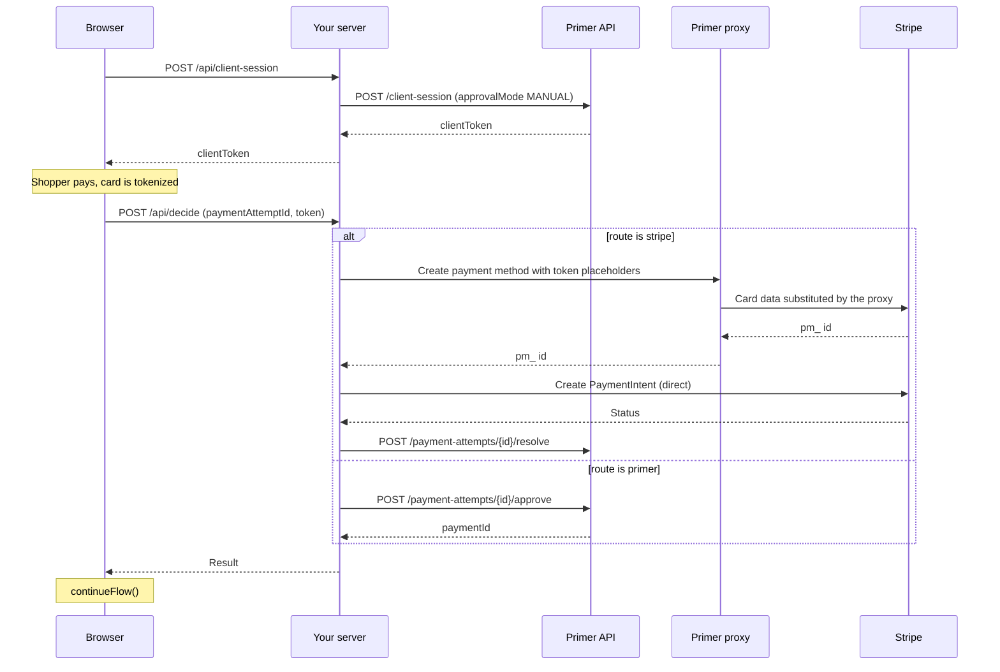

# Primer Vault: decide on the backend how each payment is processed

Primer Checkout collects the card and Primer tokenizes it. `approvalMode: "MANUAL"` pauses the payment. Your backend then decides per payment: process it with your own processor (Stripe in this example) through Primer's PCI proxy and report the outcome, or approve it so your Primer Workflow processes it. Your servers never touch raw card data.

## How it works

1. `server/primer.js` creates a client session with `approvalMode: "MANUAL"`, a `customerId` and `vaultOnSuccess`.
2. `public/app.js` mounts `<primer-checkout>`. After the shopper submits the card, Primer tokenizes it and the SDK emits `primer:payment-approval-required` with a `paymentAttemptId` and a payment method token.
3. The browser sends the `paymentAttemptId` and the payment method token string to `POST /api/decide` in `server/index.js`.
4. `server/decide.js` returns `stripe` or `primer`. Your routing rule goes here.
5. `server/process.js` runs the chosen path. Stripe: `server/proxy.js` creates a Stripe payment method through Primer's PCI proxy, `server/stripe.js` charges it, and the outcome is reported to Primer with the resolve call (`POST /payment-attempts/{id}/resolve`), as `SUCCEEDED` or `FAILED`. Primer: the attempt is approved.
6. The browser calls `continueFlow()` so the SDK resumes and emits its final event: `primer:payment-success-external` after the Stripe path, `primer:payment-success` after the Primer path, `primer:payment-failure` on failure.



## Prerequisites

- A Primer sandbox account with Vault enabled.
- A Primer API key with the scopes `client_tokens:write`, `transactions:authorize`, `transactions:read` and `payment_instrument:write`.
- A Primer Workflow with a processor, for the Primer path.
- A Stripe test account with raw card data access (Stripe support enables it).
- Node 22 or later.

## Run it

```bash
cp .env.example .env   # fill in PRIMER_API_KEY and STRIPE_SECRET_KEY
npm install
npm start
```

The server reads `.env` only at startup, so restart it after any change.

Open http://127.0.0.1:3000 and pay with a test card. Which cards work depends on the route:

- Stripe route: Stripe takes the card, so [Stripe test cards](https://docs.stripe.com/testing) apply.
- Primer route: the processor in your Primer Workflow takes the card. For the Primer Sandbox Processor, see [Primer Sandbox Processor](https://primer.io/docs/testing/primer-sandbox-processor).

`4242 4242 4242 4242` worked on both routes in our sandbox run.

The page has a demo route picker, shown only when `NODE_ENV` is not `production`. `ROUTE` in `.env` sets the backend default.

## What a successful run looks like

Server log on the Stripe route:

```text
[session] client session created
[decide] attempt <attempt id> -> stripe
[proxy] card forwarded to Stripe as pm_…
[stripe] pi_… succeeded
[primer] resolved <attempt id> SUCCEEDED
```

Server log on the Primer route:

```text
[session] client session created
[decide] attempt <attempt id> -> primer
[primer] approved <attempt id> -> payment <payment id> PENDING
```

The "What happened" list on the page, Primer route:

```text
Checkout ready
Payment paused for approval: attempt <attempt id>
Backend chose: primer
Primer payment <payment id> is PENDING, approved
Checkout finished: payment-success
```

Stripe route:

```text
Checkout ready
Payment paused for approval: attempt <attempt id>
Backend chose: stripe
Stripe PaymentIntent pi_… succeeded, resolved SUCCEEDED
Checkout finished: payment-success-external
```

The server makes every Stripe call, so the browser never sees Stripe's response. It only receives the summary from `POST /api/decide`, which you can see in the Network tab's Response. The full detail is in the server log and in the Stripe Dashboard (test mode), where you can search for the `pi_…` id.

On the Primer route, the server reads the payment straight after approve, so the payment can still be `PENDING`, as it was in our sandbox run. The checkout still finishes with `payment-success`. For the final status, check the Primer Dashboard.

## Things to know

- The decision window is 15 minutes from the moment the card is tokenized ([Vault reference](https://primer.io/docs/vault/reference#payment-attempt-states-and-decision-window)). After it, approve returns `410 PaymentAttemptExpired` and resolve fails. This example handles a 410 from either call the same way.
- If Stripe charges and resolve then fails, the shopper has been charged. Reconcile: refund the Stripe PaymentIntent, or record the payment in your own systems.
- If Stripe does not confirm the charge (timeout, network error, Stripe 5xx or an idempotency conflict), the server does not resolve and returns `charged: "unknown"`. Check the PaymentIntent in Stripe before you refund or retry. If the proxy call itself did not complete, check Stripe for a PaymentMethod instead.
- If the proxy answers `409` (`token-consumed`), an earlier request already used the token, and this request forwarded nothing to Stripe. The server resolves `FAILED` and returns 200 `FAILED`. If an earlier request did charge, its own response says so.
- If approve answers `409 IdempotencyKeyAlreadyExists`, an earlier approve already created the payment. The server returns 200 `APPROVED` without a payment id. Find the payment in the dashboard. Other approve 409s are rejections.
- Always call `continueFlow()`, even on errors. If you don't call `continueFlow()`, the SDK checks the attempt on its own only after 90 seconds.
- `requires_action` (Stripe 3DS) is treated as failed in this example.
- Idempotency: Approve sends a fresh key per request. Resolve is idempotent on `paymentAttemptId`. The proxy and PaymentIntent calls use keys derived from `paymentAttemptId`, and Primer's proxy forwards the key to Stripe, so retrying the same route can't charge twice while [Stripe keeps the key](https://docs.stripe.com/api/idempotent_requests) (24 hours).
- The server listens on `127.0.0.1` by default. The endpoints have no authentication, so don't expose them as they are.

## Docs

- [Vault overview](https://primer.io/docs/vault/overview)
- [Get started with Vault](https://primer.io/docs/vault/get-started)
- [During the payment (proxy and resolve)](https://primer.io/docs/vault/during-the-payment)
- [Vault reference](https://primer.io/docs/vault/reference)
- [Manual payment approval](https://primer.io/docs/checkout/primer-checkout/guides-and-recipes/manual-payment-approval)
- [Checkout events reference](https://primer.io/docs/sdk/primer-checkout-web/events-reference)
- [Install Primer Checkout](https://primer.io/docs/checkout/primer-checkout/installation)
